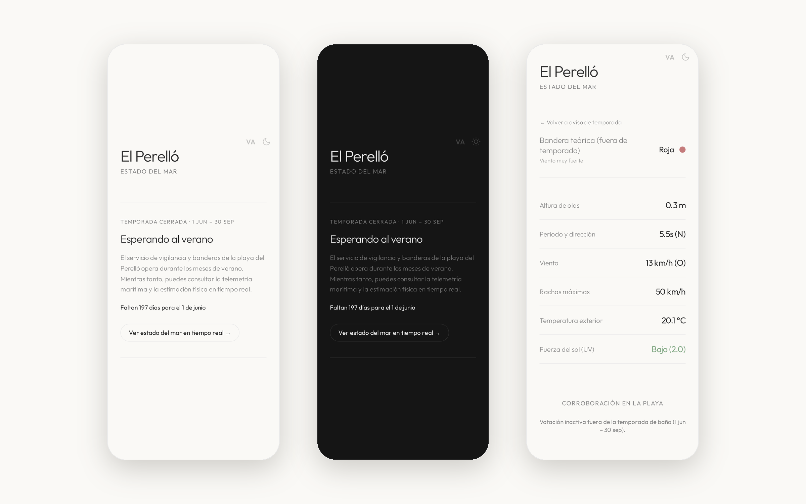
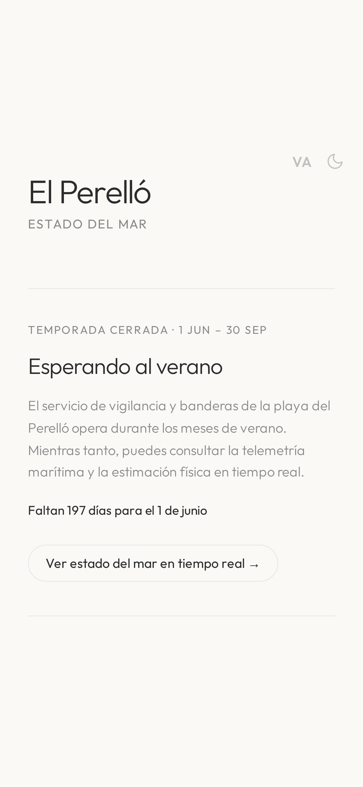
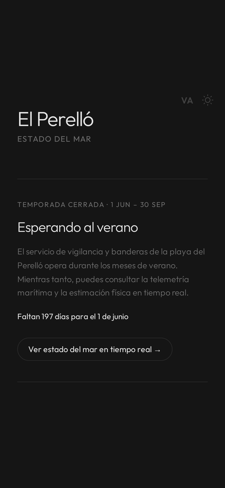
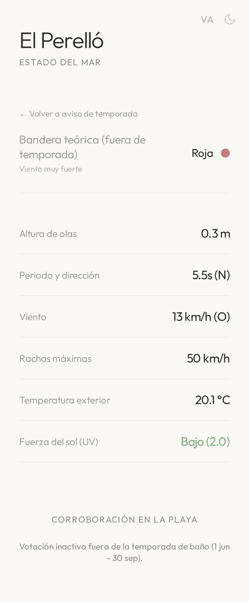
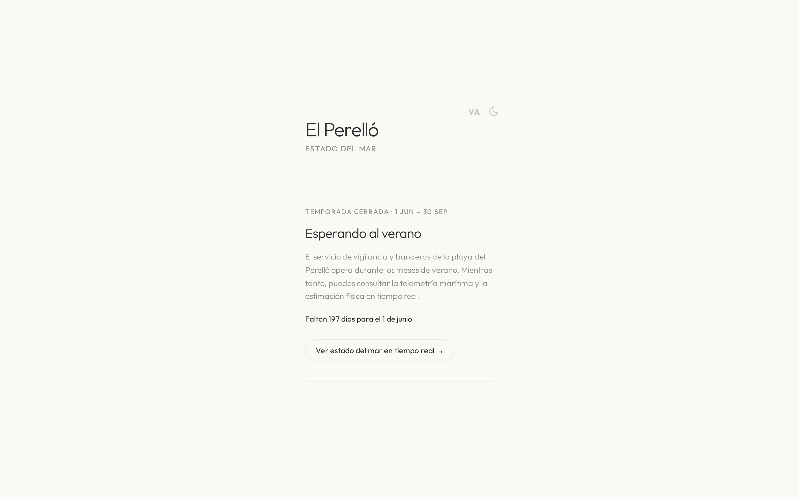

<p align="center">
  
</p>

<p align="center">
  <a href="README.md">English</a> · <strong>Español</strong>
</p>

<p align="center">
  <a href="https://github.com/Ivan-olivera-dev/playaperello/actions/workflows/ci.yml"></a>
  <a href="https://playaperello.es"></a>
</p>

# Playa del Perelló

Aplicación web que sigue el estado del mar y estima la bandera de seguridad de la playa de El Perelló (Sueca, Valencia). Combina datos de oleaje marino con las lecturas de la estación meteorológica local y permite a quien está en la playa votar la bandera que ondea de verdad en el puesto de socorrismo. Disponible en [playaperello.es](https://playaperello.es).

<p align="center">
  
</p>

## Capturas de pantalla

| Móvil, claro | Móvil, oscuro | Vista en directo | Escritorio |
| :---: | :---: | :---: | :---: |
|  |  |  |  |

<sub>Capturas de la web en playaperello.es, tomadas en noviembre de 2026 (fuera de temporada, así que la vista en directo muestra la bandera teórica y la votación está cerrada).</sub>

## Por qué lo hice

Después de las obras de regeneración de arena en El Perelló, en la orilla se formó un escalón muy pronunciado justo donde rompe el agua. En dos pasos pasas de tener el agua por los tobillos a no hacer pie, y eso hace que las olas de orilla sean bastante más bravas de lo que indican las apps del tiempo habituales.

Esta app combina datos de oleaje marino con las lecturas de la estación meteorológica local de El Perelló para estimar qué bandera (verde, amarilla o roja) corresponde a las condiciones actuales, y permite a quien está en la playa votar para confirmar la bandera real del puesto de socorrismo.

## Cómo funciona

Cada 60 segundos (mediante ISR de Next.js), el servidor consulta dos fuentes de datos:
1. Open-Meteo Marine API para la altura de ola, el periodo de ola y la dirección del oleaje frente a El Perelló (`39.278, -0.278`).
2. Inforatge El Perelló para la velocidad del viento local, las rachas, la dirección del viento, la temperatura y el índice UV.

La lógica de estimación de la bandera en `src/lib/beach-logic.js` tiene en cuenta que la playa está orientada al este (~75° a 90°) y aplica un multiplicador cuando el mar de fondo de periodo largo (`>= 6.0s`) llega al escalón de la orilla. También distingue los vientos de mar (levante y gregal, que empujan las olas y las corrientes contra el escalón) de las brisas térmicas de la tarde, más suaves (garbí), y de los vientos de tierra (poniente).

```text
┌────────────────────────────┐   ┌────────────────────────────┐
│   Open-Meteo Marine API    │   │  Inforatge Local Station   │
│ (Swell Height/Period/Dir)  │   │ (Wind, Gusts, Temp, UV)    │
└─────────────┬──────────────┘   └─────────────┬──────────────┘
              └──────────────┬─────────────────┘
                             v (Next.js Server Component, ISR 60s)
              ┌──────────────────────────────┐
              │       Flag Estimation        │
              │    src/lib/beach-logic.js    │
              └──────────────┬───────────────┘
                             v
              ┌──────────────────────────────┐
              │   DashboardClient (ES / VA)  │ <---> /api/votes (SQLite)
              └──────────────────────────────┘
```

### Modo de temporada y votación en la playa

El servicio de socorrismo de El Perelló funciona del 1 de junio al 30 de septiembre. Fuera de esos meses, la web muestra una pantalla de fuera de temporada con una cuenta atrás hasta el 1 de junio y un botón para consultar igualmente la telemetría en directo y la bandera teórica.

En verano, los visitantes pueden votar la bandera actual durante el horario de socorrismo (de `07:00` a `15:00` y de `16:00` a `21:00`, hora de `Europe/Madrid`). Los votos se guardan por turno en una base de datos SQLite local (`/app/data/votes.sqlite`). La interfaz está disponible en castellano y valenciano, con tema claro y oscuro.

## Fuentes de datos

- [Open-Meteo Marine API](https://open-meteo.com/en/docs/marine-weather-api): altura, periodo y dirección de las olas.
- [Inforatge El Perelló](https://inforatge.com/meteo-elperello): viento local, rachas, temperatura e índice UV.

## Stack técnico

- Next.js 16 (App Router, Server Components, ISR)
- React 19
- SQLite mediante `sqlite3` para los votos de la playa
- `node:test` para los tests de las reglas de temporada y de la estimación de la bandera
- Docker, desplegado con Coolify
- GitHub Actions para la CI

## Desarrollo local

Instala las dependencias y arranca el servidor de desarrollo:

```bash
npm ci
npm run dev
```

La app se sirve en `http://localhost:3000`.

Para ejecutar los tests unitarios de las reglas de temporada y de la lógica de estimación de la bandera:

```bash
npm test
```

## Despliegue

El proyecto se compila como una imagen standalone de Next.js con el `Dockerfile` y el `docker-compose.yml` incluidos, montando `./data:/app/data` para que la base de datos SQLite se conserve entre despliegues:

```bash
docker compose up -d --build
```

## Autor

[Iván Olivera González](https://ivanolivera.dev)
