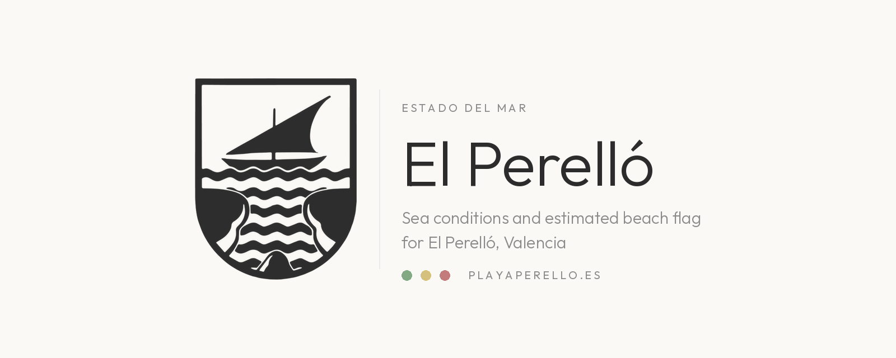
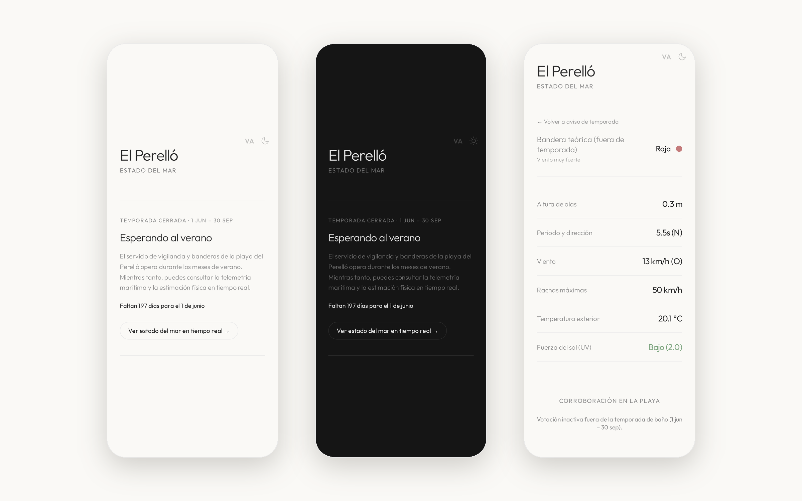
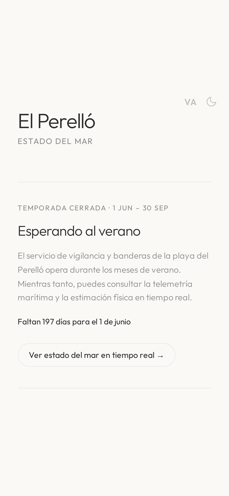
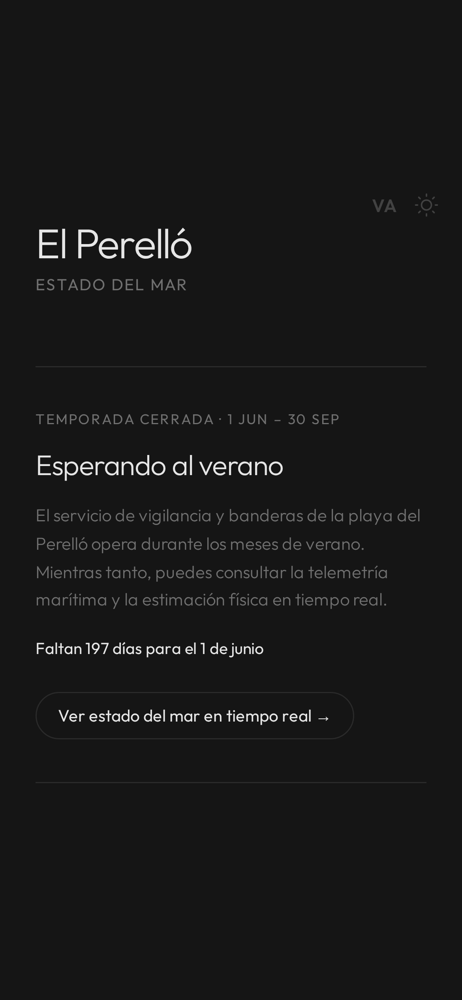
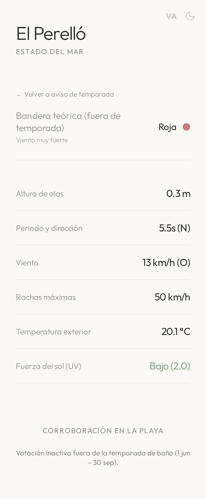
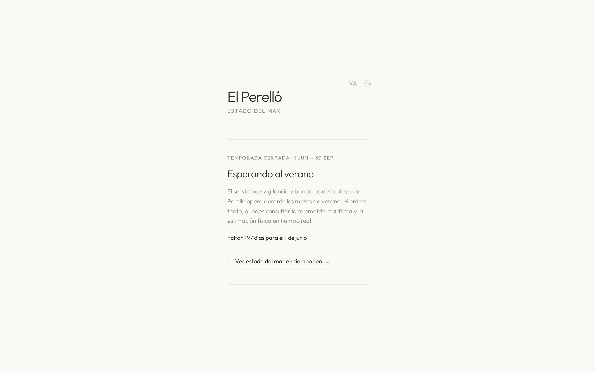

<p align="center">
  
</p>

<p align="center">
  <a href="https://github.com/Ivan-olivera-dev/playaperello/actions/workflows/ci.yml"></a>
  <a href="https://playaperello.es"></a>
</p>

# Playa del Perelló

Web app that tracks sea conditions and estimates the beach safety flag for El Perelló (Sueca, Valencia). It combines marine swell data with readings from the local weather station, and lets people at the beach vote on the flag actually flying on the lifeguard post. Live at [playaperello.es](https://playaperello.es).

<p align="center">
  
</p>

## Screenshots

| Mobile, light | Mobile, dark | Live view | Desktop |
| :---: | :---: | :---: | :---: |
|  |  |  |  |

<sub>Captures of the live site at playaperello.es, taken in November 2026 (off-season, so the live view shows the theoretical flag and voting is closed).</sub>

## Why I built it

After the sand regeneration works in El Perelló, the shoreline developed a steep drop-off right at the water's edge. Within two steps you go from ankle-deep water to not touching the bottom, which makes shorebreak waves much rougher than standard weather apps suggest.

This app combines marine swell data with readings from the local weather station in El Perelló to estimate which flag (Green, Yellow, or Red) fits current conditions, and lets people at the beach vote to confirm the actual flag on the lifeguard post.

## How it works

Every 60 seconds (via Next.js ISR), the server fetches two data sources:
1. Open-Meteo Marine API for wave height, wave period, and swell direction off El Perelló (`39.278, -0.278`).
2. Inforatge El Perelló for local wind speed, wind gusts, wind direction, temperature, and UV index.

The flag estimation logic in `src/lib/beach-logic.js` accounts for the East-facing orientation of the beach (~75° to 90°) and applies a multiplier when long-period swell (`>= 6.0s`) hits the shore step. It also separates onshore winds (Levante and Gregal, which push waves and currents into the step) from milder afternoon thermal breezes (Garbí) and offshore winds (Poniente).

```text
┌────────────────────────────┐   ┌────────────────────────────┐
│   Open-Meteo Marine API    │   │  Inforatge Local Station   │
│ (Swell Height/Period/Dir)  │   │ (Wind, Gusts, Temp, UV)    │
└─────────────┬──────────────┘   └─────────────┬──────────────┘
              └──────────────┬─────────────────┘
                             v (Next.js Server Component, ISR 60s)
              ┌──────────────────────────────┐
              │       Flag Estimation        │
              │    src/lib/beach-logic.js    │
              └──────────────┬───────────────┘
                             v
              ┌──────────────────────────────┐
              │   DashboardClient (ES / VA)  │ <---> /api/votes (SQLite)
              └──────────────────────────────┘
```

### Seasonal mode and beach voting

Lifeguard service in El Perelló runs from June 1 to September 30. Outside those months, the site shows an off-season screen with a countdown to June 1 and a button to inspect the live telemetry and theoretical flag anyway.

During summer, visitors can vote on the current flag during lifeguard hours (`07:00` to `15:00` and `16:00` to `21:00`, `Europe/Madrid` time). Votes are stored by shift in a local SQLite database (`/app/data/votes.sqlite`). The interface is available in Spanish and Valencian, with light and dark themes.

## Data sources

- [Open-Meteo Marine API](https://open-meteo.com/en/docs/marine-weather-api): wave height, period and direction.
- [Inforatge El Perelló](https://inforatge.com/meteo-elperello): local wind, gusts, temperature and UV index.

## Tech stack

- Next.js 16 (App Router, Server Components, ISR)
- React 19
- SQLite via `sqlite3` for beach votes
- `node:test` for the seasonal rules and flag estimation tests
- Docker, deployed with Coolify
- GitHub Actions for CI

## Local development

Install dependencies and start the development server:

```bash
npm ci
npm run dev
```

The app runs at `http://localhost:3000`.

To run the unit tests for the seasonal rules and flag estimation logic:

```bash
npm test
```

## Deployment

The project builds as a standalone Next.js image via the included `Dockerfile` and `docker-compose.yml`, mounting `./data:/app/data` so the SQLite database persists across deploys:

```bash
docker compose up -d --build
```

## Author

[Iván Olivera González](https://ivanolivera.dev)
